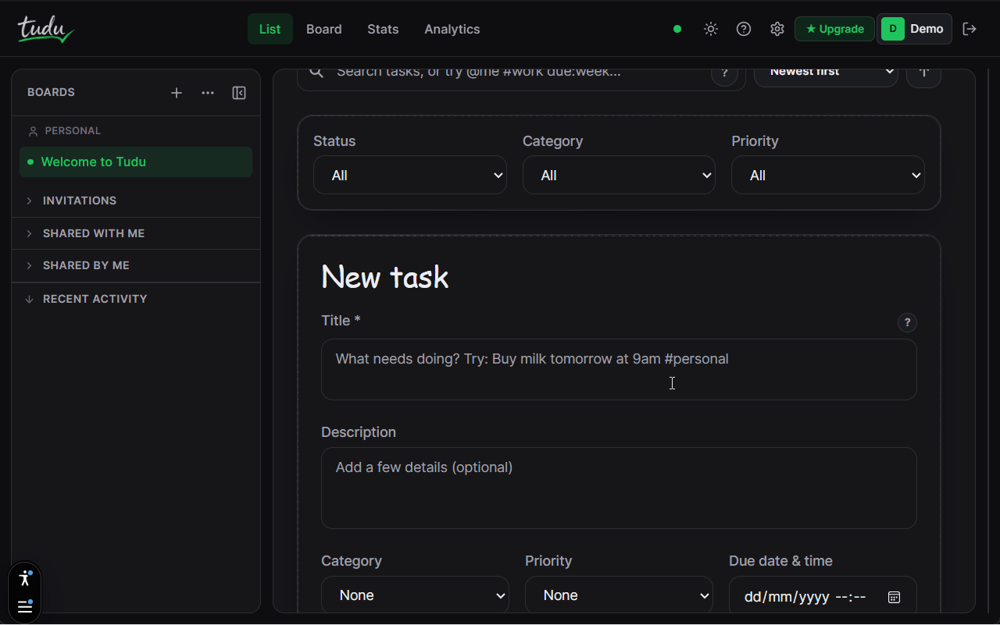
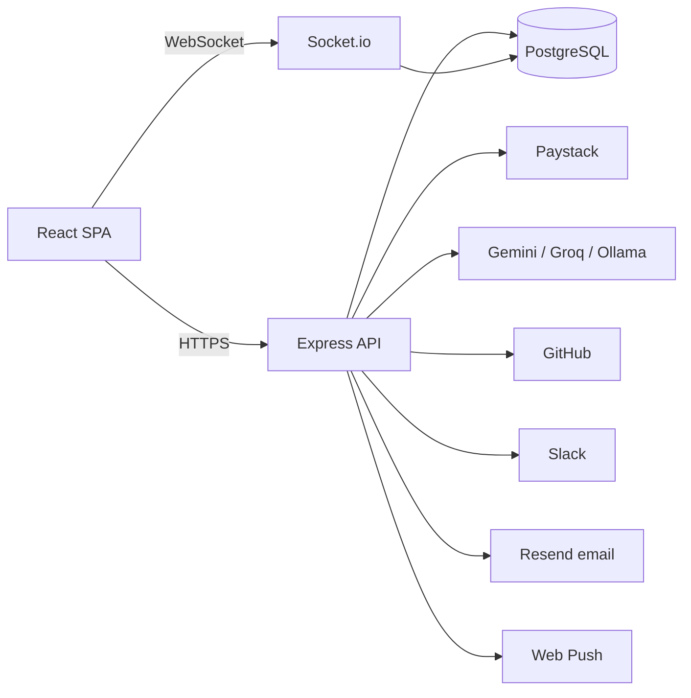

# Tudu

The fast, offline-first Kanban for people tired of Trello's limits and
Jira's chaos. Built as a PERN app (Postgres + Express + React + Node),
self-hostable, and open source under AGPL-3.0.



[](https://github.com/MojolaoluwaOlanusi/Tudu/actions/workflows/ci.yml)
[](LICENSE)
[](https://github.com/MojolaoluwaOlanusi/Tudu/releases)
[](https://github.com/MojolaoluwaOlanusi/Tudu/stargazers)
[](https://github.com/MojolaoluwaOlanusi/Tudu/commits/main)

## What it is

Tudu is a personal and small-team task manager with a real Kanban board,
natural-language input, a built-in Pomodoro timer, and personal plus team
analytics. It has one paid tier (Pro) with a working Paystack integration,
template marketplace, public API, and self-hosting licence. There is no
enterprise tier today; see `docs/ENTERPRISE.md` for what is planned.

## What ships today

| Area | Feature |
|---|---|
| Tasks | CRUD, subtasks, categories (work / personal / study), priorities, due dates |
| Boards | Kanban, custom columns, WIP limits, column drag reorder, multi-card drag |
| Input | Natural-language parsing ("Buy milk tomorrow 9am #personal urgent") |
| AI | Task breakdown with Gemini, Groq, or local Ollama (free + Pro HD tiers, credit metered) |
| Focus | Pomodoro timer with background-safe countdown + focus stats |
| Time | Time tracking with manual entries, billable flag, weekly reports (Pro) |
| Analytics | Personal + team dashboards, CSV / JSON export (team is Pro) |
| Collaboration | Workspaces (admin / member / viewer), invitations, shared lists by email |
| Integrations | GitHub (OAuth + PR-to-card + HMAC webhooks), Slack (OAuth + `/tudu create`) |
| Public API | Read (Free) and write (Pro) at `/api/v1`, personal access tokens, 100 req/min |
| Webhooks | Outbound task events, Standard Webhooks signature, 6-attempt retry |
| Marketplace | Publish free or paid templates, rent, refund within 14 days, version + sync |
| Billing | Paystack subscriptions (Pro monthly / yearly), AI credit bundles |
| Self-hosting | Ed25519-signed licence files, instance-wide Pro, offline verification |
| PWA | Install prompt, offline cache, browser push notifications |
| UX | Command palette (Cmd/Ctrl+K), keyboard shortcuts, undo (soft delete), dark mode |
| Landing | Real marketing pages: `/docs`, `/help`, `/pricing`, `/changelog`, `/blog`, `/status` |

## Screenshots

Screenshots are in `docs/screenshots/`. Representative set:

- `list.png` - the list view with filters and recent activity
- `board.png` - Kanban board with custom columns and WIP badges
- `analytics.png` - the personal analytics dashboard
- `marketplace.png` - template marketplace
- `mobile.png` - mobile list view

(Add these files before merge; the README expects them to exist.)

## Quick start (local dev)

Prerequisites: Node 18+, Postgres 15+, a Google and/or GitHub OAuth app
(optional but recommended), and one AI provider key (Gemini / Groq /
Ollama) if you want AI breakdown.

```bash
# 1. Clone
git clone https://github.com/MojolaoluwaOlanusi/Tudu.git
cd Tudu

# 2. Backend
cd backend
npm install
cp .env.example .env
# Edit .env: DATABASE_URL, JWT_SECRET, SESSION_SECRET are the minimum.
# Add GEMINI_API_KEY (or GROQ_API_KEY, or leave blank for AI disabled).
npm run migrate
npm run dev    # http://localhost:5000

# 3. Frontend (new terminal)
cd ../frontend
npm install
cp .env.example .env
npm run dev    # http://localhost:5173
```

For every environment variable, OAuth setup, Paystack, email, push, and
Slack/GitHub walkthroughs, see `docs/SELF_HOSTING.md`.

## Architecture

A single Express API with a Postgres pool, a [Socket.io](https://socket.io/) server layered onto
the same HTTP server, and a Vite/React SPA. Real-time updates are pushed
to per-user [Socket.io](https://socket.io/) rooms; the SPA applies them to a React Query cache.



## Tech stack

Exact versions in `backend/package.json` and `frontend/package.json`.

**Backend** - Express 4, `pg` (raw SQL, no ORM), Passport (Google +
GitHub), JWT (jsonwebtoken), bcryptjs, [Socket.io](https://socket.io/), express-rate-limit,
Helmet, Zod (request validation on `/api/v1`), chrono-node, date-fns,
`@octokit/rest`, `web-push`, `resend`.

**Frontend** - React 18, Vite 5, TypeScript 5, Zustand (state), React
Query 5 (server state), React Router 6, `@dnd-ki`t (drag and drop),
Chart.js (SVG charts for analytics), [Socket.io](https://socket.io/)-client, Framer Motion,
Tailwind CSS 3, `vite-plugin-pwa`, `@paystack/inline-js`,
`canvas-confetti`.

**Deployment** - Vercel (frontend), Render (backend + cron), Neon
(Postgres). Nothing about the app requires these three; they are the
maintainer's defaults.

## Repo layout

```bash
backend/       Express API + Socket.io + migrations + tests
frontend/      Vite + React SPA + tests + e2e
docs/          User-facing docs (self-hosting, marketplace, API, growth)
docs/        Internal reference (visual system, UI inventory, future work)
.github/       Issue + PR templates, CI, Dependabot
```

## Testing

```bash
# Backend
cd backend
npm run test:unit          # mocked, no DB
npm run test:integration   # against real Postgres (uses DATABASE_URL)

# Frontend
cd frontend
npm test -- --run          # vitest
npm run build              # tsc + vite build

# E2E (needs backend on :5000 and `npx playwright install chromium`)
npm run test:e2e
```

## Deployment

**Frontend** - `frontend/vercel.json` has the SPA rewrite. Set
`VITE_API_URL` and `VITE_SOCKET_URL` in the Vercel dashboard.

**Backend** - `backend/render.yaml` defines a web service + a daily
reminders cron. `DATABASE_URL`, `JWT_SECRE`T, and `SESSION_SECRET` are
the minimum; OAuth / AI / Paystack / email / push / Slack add more.

**Database** - any Postgres 15+ works. Run `npm run migrate` once
against the target.

Full details in `docs/SELF_HOSTING.md`.

## Documentation

* `docs/SELF_HOSTING.md` - complete install guide, env vars, deployment

* `docs/MARKETPLACE.md` - publishing, buying, renting, refunds, payouts

* `docs/API_AND_WEBHOOKS.md` - public API endpoints and outbound webhooks

* `docs/ENTERPRISE.md` - planned enterprise features (not shipped)

* `docs/LAUNCH_AND_GROWTH.md` - positioning, playbooks, SEO, referral

* `docs/FUTURE_WORK.md` - known deferred work

* `docs/UI.md` - component inventory

* `docs/VISUAL_SYSTEM.md` - design tokens and recipes

## Contributing

See `CONTRIBUTING.md`. Bug reports and feature requests use the issue
templates under `.github/ISSUE_TEMPLATE/`. Security reports go to the
address in `SECURITY.md`, not to public issues.

## License

AGPL-3.0. See `LICENSE`.

Enterprise features (SSO, SCIM, audit export, white-label, on-prem) are
planned to live in a separate proprietary `/ee` folder once they ship.
They do not exist today, and the AGPL core stays AGPL when they do.

## Credits

Built by Mojolaoluwa Olanusi. Thanks to the maintainers of every library
in `package.json`, and to the users who reported the first hundred bugs.
